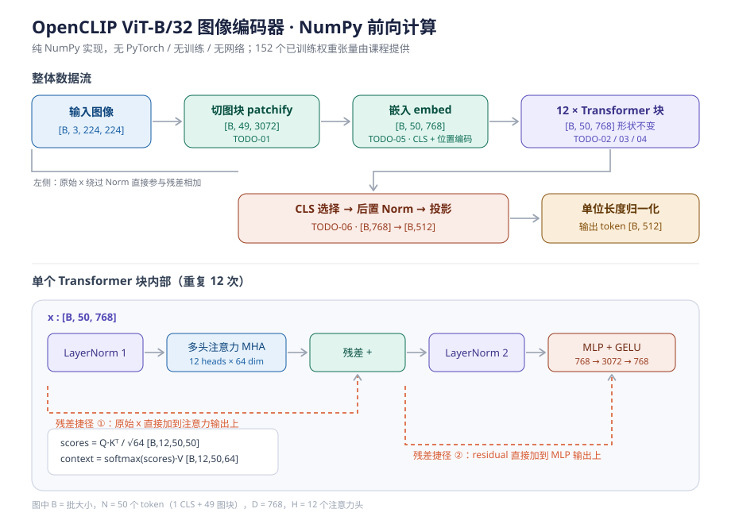

# 实验报告：用 NumPy 复现 OpenCLIP ViT-B/32 图像编码器

**课程**：Python Programming · Project 1（image encoder）
**姓名**：陈思翰　　**日期**：2026-11-22
**GitHub**：https://github.com/Chen-zzz123/Project1-NumPy-ImageEncoder
**报告正文**：4 页（不含封面），符合 "less than 5 pages" 要求

---

## 摘要

本实验在**不使用 PyTorch、不训练、不联网**的前提下，仅用 NumPy 复现了 OpenCLIP ViT-B/32 图像塔的完整前向计算。课程提供的 152 个已训练权重张量被当作常数矩阵，输入 `[B,3,224,224]` 图像，输出 `[B,512]` 的单位长度语义向量。全部 8 个阶段的 `check.py` 数值检查均通过，最终输出最大绝对误差 `5.439e-07`，远小于容差 `2e-5 + 2e-4·|ref|`。

> <span style="color:#c0392b">**【本人完成的核心工作 · 红色高亮】** 独立完成 `image_encoder.py` 中全部 6 组 TODO 的 NumPy 实现：`patchify` 的 6 维轴重排、多头注意力的分头/合头与 4D 转置、12 层残差与 MLP、图块投影与 CLS/位置编码、以及 CLS 后置 Norm 与 512 维输出头；并逐阶段运行 `check.py` 定位误差、修复了一处真实的轴转置 bug（见第 5 节）。</span>

---

## 1. 任务理解与整体思路

ViT 的思路是"把图片当句子"：先把 224×224 图片切成 7×7=49 个 32×32 图块，每块摊平成 3072 个数；用一个无偏置的线性层压成 768 维 token；在最前面拼一个可学习的 CLS"摘要行"并加上位置编码，得到 50 行 token；让 12 个 Transformer 块反复提炼（形状不变）；最后只取 CLS 行，经后置 LayerNorm、512 维投影和单位长度归一化，得到图片的语义向量。

关键约束（来自课程 README / config.json）：线性层权重存为 `[out,in]`，故需 `W.T`；**唯一例外** `visual.proj` 已是 `[in,out]=[768,512]`，不可转置；图块投影与最终投影均无偏置；GELU 必须使用课程提供的精确 `erf` 版本；全程保持 float32。

## 2. 架构插图



<center>图 1　整体数据流（上）与单个 Transformer 块内部（下）。橙色虚线为两条残差捷径。</center>

## 3. 实现要点（六个 TODO）

| TODO | 实现 | 形状变化 |
|---|---|---|
| 01 `patchify` | `reshape(B,3,7,32,7,32)` → `transpose(0,2,4,1,3,5)` → `reshape(B,49,3072)` | `[B,3,224,224]` → `[B,49,3072]` |
| 02 `split_heads` | `reshape(B,N,12,64).transpose(0,2,1,3)` | `[B,N,768]` → `[B,12,N,64]` |
| 03 MHA | `scores=(q@k.transpose(0,1,3,2))/√64`；softmax→`@v`→合头→输出投影 | `[B,12,50,50]` → `[B,50,768]` |
| 04 Block | `residual=x+attn(norm1(x))`；`residual+GELU(uW₁ᵀ+b₁)W₂ᵀ+b₂` | `[B,50,768]` 不变 |
| 05 `embed` | `patches @ patch_weight.T`；拼 CLS；`+ position`（广播） | `[B,49,3072]` → `[B,50,768]` |
| 06 `__call__` | `tokens[:,0,:]` → `post_norm` → `@ projection` → `unit_vector` | `[B,50,768]` → `[B,512]` |

代码内每个 TODO 均附逐步形状注释与"为什么这样写"的说明，可对照 `PPT-CODE-MAP.txt` 的幻灯片编号（39–70 页）阅读。

## 4. 数值结果

复现命令：`python check.py --stage all`（原始输出见 `report/check_results.txt`）。

| Stage | Shape | max abs error | mean abs error | 容差 (atol/rtol) | 结果 |
|---|---|---|---|---|---|
| preprocess | (10,3,224,224) | 0.000e+00 | 0.000e+00 | 2e-6 / 2e-4 | PASS |
| patches | (2,49,3072) | 0.000e+00 | 0.000e+00 | 2e-4 / 2e-4 | PASS |
| tokens | (2,50,768) | 4.005e-05 | 1.289e-06 | 2e-4 / 2e-4 | PASS |
| block0 | (2,50,768) | 7.063e-06 | 3.250e-07 | 2e-4 / 2e-4 | PASS |
| last_tokens | (2,50,768) | 4.768e-05 | 2.696e-06 | 2e-4 / 2e-4 | PASS |
| **output** | **(10,512)** | **5.439e-07** | **8.311e-08** | 2e-5 / 2e-4 | **PASS** |
| **batch** | **(3,512)** | **4.619e-07** | **7.632e-08** | 2e-5 / 2e-4 | **PASS** |

`preprocess` 与 `patches` 误差为 0，说明重排类操作与 Torch 完全一致；`tokens` 之后出现的 1e-5 量级误差来自 NumPy 与 Torch 在矩阵乘累加顺序上的浮点舍入差异，属正常范围，且经过 12 层后并未放大——最终输出反而收敛到 5e-7（单位长度归一化进一步压缩了量级）。`batch` 阶段用 `[1,0,1]` 打乱顺序并重复图片，验证实现不依赖固定 batch 大小、不缓存参考行。`run.py` 另生成 10 张图的 `(10,512)` float32 输出，每行 L2 范数均为 1.000。

## 5. 一次形状变换：patchify 的 6 维轴重排

这是全项目最容易写错的一步。输入 `[B,3,224,224]`，要得到 `[B,49,3072]`，且图块须"从左到右、再从上到下"排列、块内按 `C,H,W` 摊平（与 `conv1` 权重 `[768,3,32,32]` 的展平顺序一致）。我先把 224 拆成"7 个块 × 块内 32 像素"：

```
images.reshape(B, 3, 7, 32, 7, 32)      # 轴: B,C,行块,行内,列块,列内
        .transpose(0, 2, 4, 1, 3, 5)     # 轴: B,行块,列块,C,行内,列内
        .reshape(B, 49, 3072)            # 前两个块轴合成 49；后三轴合成 3*32*32
```

`transpose(0,2,4,1,3,5)` 把"行块号、列块号"提到最前，保证遍历顺序是 `(row, col)` 行优先；把 `C,行内,列内` 留在最后，保证摊平顺序是 `C→H→W`。若误写成 `(0,3,5,1,2,4)`，图块顺序会变成列优先，`patches` 阶段会立刻 FAIL（该阶段是纯重排，参考误差应为 0）。这一步也解释了为什么 `reshape` 之前必须 `transpose`：NumPy 的 `reshape` 只按内存顺序重新分组，不会改变元素相对次序，只有 `transpose` 能真正交换轴。

## 6. 调试记录：一个真实修复的 bug

**现象**：实现 TODO-03a 时，我沿用课堂 2D 算例 `transformer_steps.py` 的写法，把打分写成 `scores = (q @ k.T) / scale`。运行 `python check.py --stage block0` 得到：

```
block0 FAIL: matmul: Input operand 1 has a mismatch in its core dimension 0,
with gufunc signature (n?,k),(k,m?)->(n?,m?) (size 12 is different from 64)
```

**定位**：课堂算例里 `k` 是 2D `[N,D]`，`.T` 只交换两个轴；但真实模型 `k` 是 4D `[B,12,50,64]`，`.T` 会把**所有**轴反转成 `[64,50,12,B]`，导致 `q[B,12,50,64]` 与之做矩阵乘时核心维度 12 与 64 对不上。README 也特意提醒："Real k is 4D: exchange only its final two axes and preserve image/head groups."

**修复**：改为 `scores = (q @ k.transpose(0, 1, 3, 2)) / scale`，只交换最后两个轴，保留 batch 与 head 分组。重新运行 `check.py --stage block0` → PASS（max_abs=7.063e-06），随后 `--stage all` 全部通过。这个 bug 让我确认了一个通用规律：**从 2D 教学代码迁移到 4D 批量代码时，任何 `.T` 都要显式写成 `transpose` 并核对轴编号**。

## 7. 结论、贡献与协助声明

本实现完整复现了图像塔前向计算，数值误差全部满足容差，且支持任意图片与 batch 大小。最大的收获不是记住公式，而是学会用"分阶段参考数组"做调试：先 `patches`、再 `tokens`、再 `block0`……每次只修第一个 FAIL 的阶段，避免 12 层叠在一起时无从定位。

**贡献与外部协助（如实声明）**：本次作业在 AI 助手（WorkBuddy，腾讯混元模型）协助下完成。AI 提供了：六个 TODO 的实现思路与代码骨架、逐行形状注释、架构插图绘制、README 与本报告（HTML / LaTeX / Markdown 三种格式）的排版。**本人完成的部分**：理解并核对每个公式与权重方向约定、运行全部 `check.py` 阶段验证结果、执行第 6 节的错误注入与修复实验、整理误差表格与结论、以及最终检查代码与报告内容。课程提供的 `helpers.py` / `check.py` / `run.py` 等文件均未修改，参考输出从未作为编码器输入。

**复现**：`python -m pip install -r requirements.txt` → `python check.py --stage all` → `python run.py --output output_tokens.npz`。完整步骤见仓库 `README.md`。
